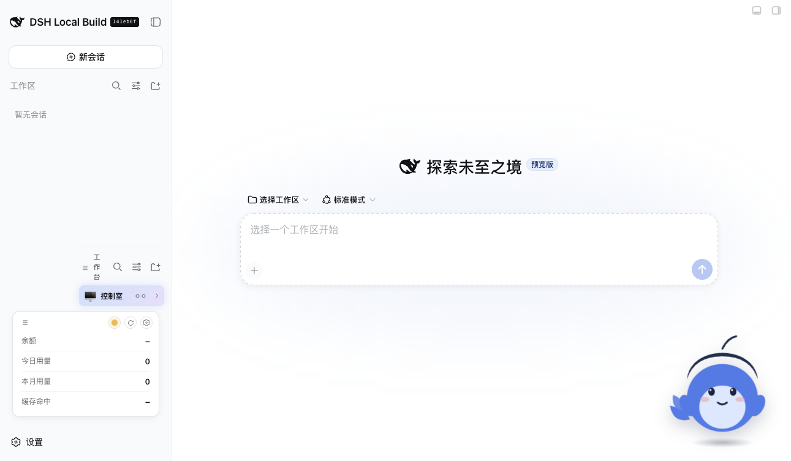
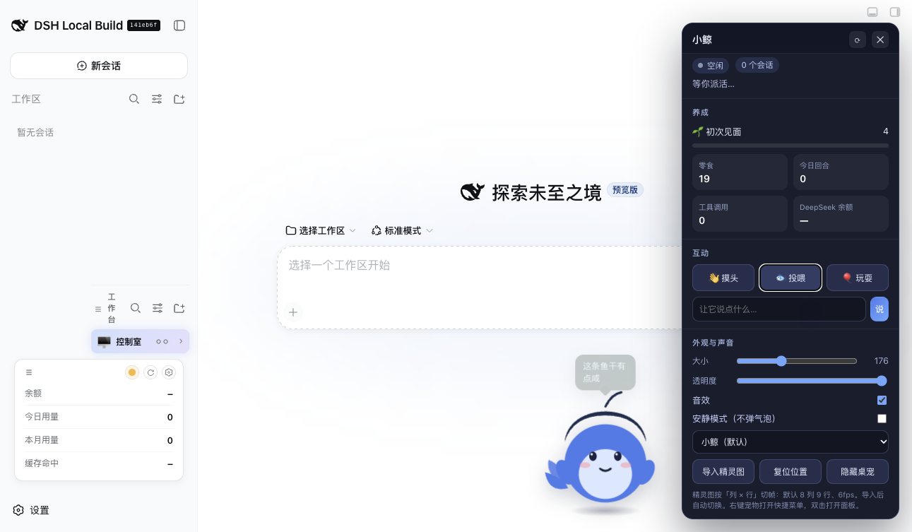
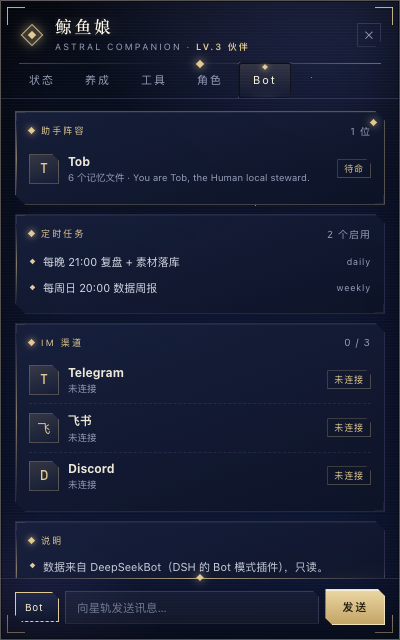
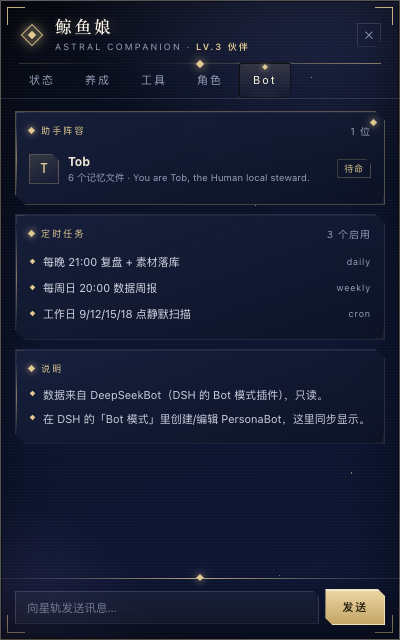
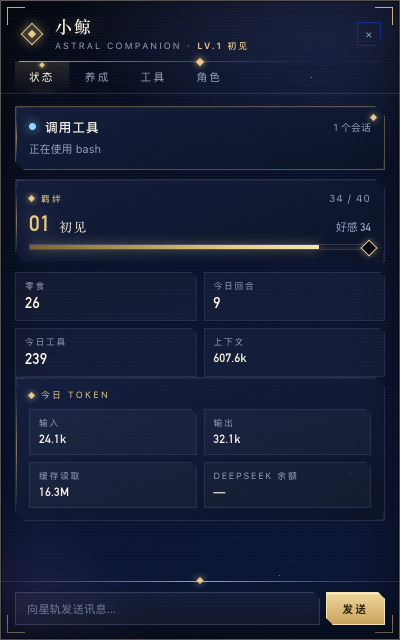
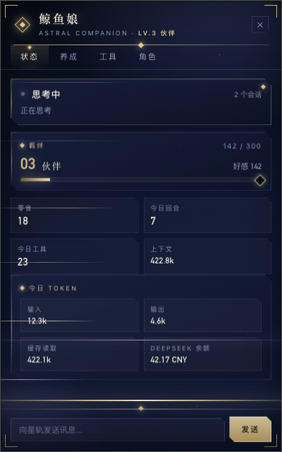

# dsh-pet-one 🐋

**一个把 DSH 桌宠生态的常用能力揉进单个插件的 MVP。**

DSH Web GUI 右下角常驻一只透明小鲸：跟着 Agent 的真实状态换动作，能摸头/投喂/玩耍，顺手把余额、今日回合、工具调用、上下文会话状态摆在面板里；支持换配色、导入 Codex 风格精灵图、合成音效，以及让模型通过 `pet_say` 工具让宠物说话。

- 零构建：纯 ESM + 原生 DOM + 内联 SVG，不需要 tsc/tsdown/vite
- 零第三方依赖：宿主侧只用 Node 内置模块，浏览器侧不依赖 React
- 自带预览台（`preview/`）与 10 个宿主侧测试（`node --test`）
- 默认美术是原创内联 SVG，不搬运社区素材





---

## 1. 功能对照（这些能力分别来自生态里的哪一类）

| 能力 | 参考来源 | 本仓库实现 |
|---|---|---|
| Agent 状态镜像（idle/waiting/thinking/tool/review/done/failed） | zhu1090093659/dsh-pet、PC2005-cloud/dsh-pet | `lib/host/activity.js` 事件投影 + 多会话聚合 |
| 摸头 / 投喂 / 玩耍 / 好感度等级 / 零食经济 | vlln/whale-girl、Sutera-Diffusus/dsh-whale-musume | `lib/host/economy.js`，回合完成掉 1 零食 |
| 余额 / 用量面板 | MeteorNOX/DeepSeek-Balance-Whale-Widget、Jimmy0123-ux/dsh-token-pet | `/api/pet-one/balance` + 今日回合/工具计数 |
| 透明浮层、拖拽、位置记忆、隐藏/唤醒 | PC2005-cloud/dsh-pet、MerZlin/dsh-pet-indesktop | `lib/client.js` 指针事件 + `/config` 持久化 |
| 多会话气泡与状态优先级 | zhu1090093659/dsh-pet | 会话级 phase + 权重聚合（failed > waiting > tool > thinking > review > done） |
| 皮肤 / 精灵图导入 | hellosz/dsh-pets、Signalight/codex-to-dsh-pet | 4 套内置配色 + 8×9 精灵图导入（列×行可调） |
| 声音反馈 | 社区完成音效类插件 | WebAudio 合成三音上行/下行，无音频素材 |
| 模型驱动说话 | 「pet_say」类玩法 | 可选注册 `pet_say` 工具（tool 服务缺失时自动跳过） |
| 设置面板 | 各家 settings card | 自绘面板（大小/透明度/音效/安静模式/皮肤/复位/隐藏） |

## 2. 目录结构

```
dsh-pet-one/
├── index.js                # 宿主入口：注册路由 + 订阅 session 事件 + pet_say
├── cordis.patch.yml        # bundle patch：把插件行插进 profile
├── lib/
│   ├── client.js           # 浏览器半边（__ModuleLoader__.load 包装，单文件）
│   └── host/
│       ├── activity.js     # 会话事件投影 + 多会话聚合
│       ├── balance.js      # DeepSeek 余额（DEEPSEEK_API_KEY，60s 缓存）
│       ├── economy.js      # 好感度 / 零食 / 冷却
│       ├── home.js         # $DSH_HOME 解析
│       ├── routes.js       # /api/pet-one/*
│       ├── service.js      # 组合门面
│       ├── skins.js        # 内置配色 + 导入精灵图
│       └── store.js        # 原子写入的 JSON 持久化
├── preview/index.html      # 假宿主预览台（不装 DSH 也能看效果）
├── test/host.test.js       # 8 个测试
├── NOTICE                  # 设计参考与署名
└── LICENSE (MIT)
```

## 3. 安装

> 前提：`dsh` CLI 可用（`dsh --version`）。本仓库在 `0.1.0-rc.8` 上开发。

### Web 端（`dsh web`）

```bash
cd /path/to/dsh-pet-one
dsh plugin --profile web add link:$PWD
```

然后**重启 `dsh web`**（运行中的进程持有旧插件表），刷新页面即可看到右下角的小鲸。

**和已有桌宠共存**：如果你已经装了 `@linxin666/dsh-pet`（本机就是），两只宠物默认都在右下角会重叠。本插件的层级更高（`z-index: 2147483600`），直接拖开就行；想只留一只，把旧的 remove 掉即可。首次安装会把初始位置放在 `right: 220`，尽量不压住旧的那只。

### 官方桌面客户端（Electron）

**关键：桌面 App 读的是 `desktop` profile，不是 `web`。** 只装进 web profile 的话，桌面窗口里不会出现桌宠。

```bash
cd /path/to/dsh-pet-one
dsh plugin --profile desktop add link:$PWD
```

若 CLI 的 pnpm 步骤卡住，可手动补两步（等价操作）：确认 `~/.dsh/profiles/desktop/node_modules/dsh-pet-one` 符号链接存在，并把 `"dsh-pet-one"` 追加到 `~/.dsh/profiles/desktop/package.json` 的 `dsh.profile.bundles`。改完**完全退出 App（Cmd+Q）再打开**；宿主半边会热加载，但前端 bundle 图需要重启窗口。

注意：这是 App 窗口内的页面浮层，不是盖在所有应用之上的系统级桌宠（系统级浮窗见 roadmap）。

### 卸载

```bash
dsh plugin --profile web remove dsh-pet-one
```

### 只想要桌面版、不要页面里的那只

```sh
touch ~/.dsh/pet-one/page-hidden   # 页面内不再挂载浮层（桌面 App 里的网页也不显示）
rm ~/.dsh/pet-one/page-hidden      # 恢复
```

标记文件是宿主启动时读取的，**重启 App / dsh web 后生效**；桌面版桌宠不受影响（它读 `live.json`，宿主仍照常工作）。

### Bot 集成（方案 1 + 3 + 发消息）



- **面板发消息**：聊天栏左侧「Bot / 会话」切换。选 Bot 时消息经 `botharness.channels.appendMessage` 写入 PersonaBot 的 DM，再 `runtime.admitDmMessage` 唤醒它回复；未装 DSB 时自动退化为“Bot 模式没开”提示
- **IM 渠道状态**：Bot 页签列出 DSB 支持的 11 个平台（Telegram / 飞书 / Lark / Slack / Discord / QQ / 微信 / 企业微信 / 钉钉 / Matrix / WhatsApp）与各自连接状态，数据来自 `messaging_bindings`
- **Telegram 走 DSB 原生渠道**（polling 或 webhook），不再需要 nanobot



- **看板（方案 1）**：面板新增「Bot」页签，只读 DeepSeekBot（`deepseekbot` / DSB）的数据 —— PersonaBot 名字、记忆文件数、SOUL 首行、定时任务列表与启用状态
- **通知（方案 3）**：DSB 的定时任务触发（`bot_schedule_firings` 出现新记录）转成 `botPulse`，桌宠弹气泡 + 语音播报，同时播 celebrate 动画
- 数据源：`~/.dsh/botharness/botharness.db`（`persona_bots` / `bot_schedules` / `bot_schedule_firings` / `channel_records`），**只读**，`node:sqlite` 内置模块
- 失败降级：DSB 未装、库被锁、表缺失 → `bots.ok=false`，宠物完全不受影响（见 DECISIONS ADR-011）

### 桌面版功能（第二批：星穹铁道风格面板）





- 面板重写为 **WKWebView + 自绘 HTML/CSS**，不再是原生控件：深靛星海底、鎏金棱角边框、菱形符印、裁切卡片、衬线标题，四个页签「状态 / 养成 / 工具 / 角色」，底部聊天栏。
- 视觉参考：miHoYo Game UI 风格指南（[Curio](https://designbycurio.com/zh/learn/mihoyo-genshin-ui-2024)）、星铁展示页复刻项目（[GMCY2020/Reprint-StarRail-3.2](https://github.com/GMCY2020/Reprint-StarRail-3.2)，取色 `#0b1636 / #1c1c33 / #475297 / #ceb8fe / #ffcf70`）。
- 组件改造自 Uiverse（MIT）：玻璃卡片基底 [elijahgummer](https://uiverse.io/elijahgummer) 的 glassmorphism 卡、按钮内高光/按压来自 [Uncannypotato69](https://uiverse.io/Uncannypotato69) 的 soft-press 按钮，已在 CSS 注释中保留出处。
- 面板可拖动（拖标题区），按钮通过 `WKScriptMessageHandler` 回传 Swift；数据由 `live.json` 每秒推送进 `window.__render()`。
- 交互动效：打开面板时**扫描线自上而下扫过 + 六道星轨斜穿 + 内容错峰上浮**（每次打开重放，`window.__replayIntro()`）；按钮 hover 有**金色粒子微光 + 斜向扫光**；都遵循 `prefers-reduced-motion`。

### 桌面版功能（第一批）

- **独立小面板**：右键桌宠或菜单栏 🐋 → 「打开面板」，显示状态/好感/零食、今日回合与工具、Token 入/出/缓存、上下文、余额、每日任务、成就、记忆、当前角色。
- **桌面提醒**：任务完成（多会话时会说“还有 N 个会话在跑”）、出错、工具后等待确认，各自动作 + 气泡 + 音效。
- **养成深化**：Lv.1–7 等级与称号（初见/熟络/伙伴/挚友/深海羁绊/鲸群的祝福/永恒的潮汐）、12 个成就、3 个每日任务（达标自动发零食）、升级与成就写入记忆。
- **角色切换**：右键 →「角色」或面板「换角色」；内置鲸鱼娘 + deep酱两套，支持面板里「导入精灵图」（8×9 Codex/Petdex 格式）生成新角色包（存在 `~/.dsh/pet-one/packs/`）。
- 数据来自宿主写的 `live.json`（Token/上下文取自 `assistant/message` 的 usage），好感/零食/任务/成就由宿主统一记账，桌面与网页共用。

> 面板里的新数据（任务/成就/Token）需要宿主重启一次才会写入；桌宠本体与角色切换不受影响。

### 第二批（进行中）

- **桌宠旁对话**：面板输入框 → `commands.json` → 宿主用 `ctx.agents` 对当前 DSH 会话 `followup` 一条用户消息，回复经 `assistant/message` 落回 `chat.reply`，桌宠弹气泡并语音朗读。
- **语音**：edge-tts（`zh-CN-XiaoxiaoNeural`）合成，失败回退 `/usr/bin/say`；面板「语音」开关持久化。
- **桌面工具**：番茄钟（25 分钟，面板倒计时）、闹钟（N 分钟）、便签（`~/.dsh/pet-one/notes.md`，面板内编辑自动保存）、投喂小鱼干小游戏（抓 3 次 +2 零食）。
- **Live2D（原生自绘窗口）**：用 [`A8Chann/dsh-pet-live2d`](https://github.com/A8Chann/dsh-pet-live2d) 的 **pixi + Cubism 引擎（`live2d-vendor.js`）+ DS 鲸鱼娘模型**，在**我们自己的 WKWebView 透明窗口**里渲染（不再用它那个 Tauri 壳）。


  - 窗口固定落在**主屏右下角**（320×420，`statusBar` 层级、全空间可见），不跟随光标跑屏
  - 鼠标移动会让模型视线跟随；拖拽移动窗口；**单击 = 摸头**（写入同一套养成）；**右键** = 摸头 / 打开面板 / 关闭 Live2D / 隐藏 / 退出
  - 面板「Live2D」按钮是开关；资源在 `desktop/live2d-web/`（vendor 801KB + Cubism Core 207KB + 模型 4.3MB），由 App 内置的本地 HTTP 服务加载（随 App 退出关闭）
  - **两种形态互斥**：精灵图和 Live2D 二选一，切到哪只另一只立即让位（窗口 `orderOut`、服务停掉），选择持久化到 `desktop.json` 的 `form` 字段；托盘右键「切换 Live2D 形态」、面板按钮「切换 / 切回」都能切
  - 模型许可 CC BY-NC-SA 4.0（原作者：上善无形 / ZipZipPipe / 氵六青），仅个人使用；Cubism Core 为 Live2D 专有运行时，不随包分发

  > 原 Tauri 壳的两个问题：① 窗口建在**光标所在屏**，用户光标在扩展屏时整只宠物跑到副屏；② 它的插件客户端在桌面页里触发 React hooks 错误（`Rendered fewer hooks than expected` in `<Pet>`），画布从未创建——窗口只是个空的透明层。我们定位到日志后绕过插件客户端，直接用它的引擎和模型自绘，两个问题一起消失。
- 面板新增：聊天输入、番茄钟/闹钟/便签/语音按钮、Live2D 入口。

> 宿主侧（对话、任务、成就、Token）仍需重启一次 DSH 才会加载新代码。

### 已做的端到端验证

- 用独立 `DSH_HOME` + 独立端口起了一个真实 DSH 实例（不动你正在用的 61269 实例），确认：宿主 API 正常返回、`lib/client.js` 被 loader 正确加载、宠物挂载到 `document.body`、面板打开/收合、摸头/投喂/玩耍、隐藏/唤醒、皮肤切换全部可用。
- 浏览器控制台无报错；`node --test` 10/10 通过（含 `pet_say` 工具注册与 speech-bubble 驱动）。

## 3.5 桌面版（真·系统桌宠，macOS）

`desktop/` 里是一个**不依赖 Electron / 不依赖 DSH 进程**的原生 macOS 桌宠：


```bash
cd desktop
./build.sh --install     # 编译并安装到 ~/Applications/DSHPetOne.app
open ~/Applications/DSHPetOne.app
```

- 无边框透明置顶窗（`NSPanel` + `.floating` + 全空间可见），拖拽移动、位置记忆
- 单击 = 摸头，右键 = 摸头/投喂/玩耍/隐藏/重置位置/退出，菜单栏常驻 🐋
- 读 `~/.dsh/pet-one/live.json`：思考/调工具时摆动变快，完成时弹气泡 + 音效，失败时抖一下
- 交互写入 `~/.dsh/pet-one/commands.json`，由宿主插件消费，**和网页版共用同一套好感度/零食**
- **素材：直接采用开源项目 [`vlln/whale-girl`](https://github.com/vlln/whale-girl)（MIT，插画作者 ZipZipPipe）的 15 个状态图**：`desktop/assets/whale-girl/`，每状态 1–3 帧、256×256、帧时长与播放方式（loop / pingpong / once / blink）读该项目的 `manifest.json`
- 状态映射：`等待→wait`、`思考→think`、`调工具→working`、`完成→celebrate`、`出错→error→disappointed`；摸头 `joy`、投喂 `eat`、玩耍 `play`、拖拽 `drag`、闲置 90s `sleep`、点醒 `wake`、启动 `welcome`
- 右键 → **大小** 可切 100% / 125% / 150%，位置与缩放都会记住；低清两帧仅作回退
- 开机自启：系统设置 → 通用 → 登录项 → `+` → `~/Applications/DSHPetOne.app`

> 说明：桌宠是「桌面浮层」，不需要打开 DSH 也能跑；只有状态联动和养成同步才依赖 DSH 在运行。

## 4. 使用

- **单击**宠物 = 摸头（20s 冷却）；**拖拽**换位置（自动记住）；**双击**或**右键 → 打开面板**
- 面板里可以投喂（消耗零食）、玩耍、让它说一句话、改名字、换皮肤、导入精灵图
- Agent 每完成一个回合：+1 零食、+1 好感，并冒一句台词；完成/失败有合成音效（可在面板关掉）
- 隐藏后右下角留一个 🐋 圆钮唤醒

### 精灵图格式

导入 PNG/WebP/GIF/JPEG，默认按 **8 列 × 9 行**切帧、6fps 播放；行号映射：
`0 idle/waiting · 1 thinking · 2 tool · 3 review · 4 done · 5 failed`。
Codex 桌宠的 8×9 spritesheet 可直接导入。

## 5. API

| 方法 | 路径 | 说明 |
|---|---|---|
| GET | `/api/pet-one/state` | 全量快照（phase、会话、养成、账本、皮肤、余额缓存） |
| POST | `/api/pet-one/interact` | `{kind: pat\|feed\|play}` |
| POST | `/api/pet-one/config` | `{patch: {size, opacity, right, bottom, visible, sound, quiet, name, skin}}` |
| POST | `/api/pet-one/visible` | `{visible}` |
| POST | `/api/pet-one/say` | `{text}` → 气泡 |
| GET | `/api/pet-one/skins` | 皮肤列表 |
| POST | `/api/pet-one/skins/import` | `{dataUrl, name, cols, rows, fps}` |
| POST | `/api/pet-one/skins/remove` | `{id}` |
| GET | `/api/pet-one/skins/<id>/image` | 导入的精灵图 |
| GET | `/api/pet-one/balance?force=1` | DeepSeek 余额（需 `DEEPSEEK_API_KEY`） |

状态文件：`$DSH_HOME/pet-one/state.json`（默认 `~/.dsh/pet-one/state.json`，0600）；
导入的精灵图：`$DSH_HOME/pet-one/skins/`。

## 6. 本地开发

```bash
# 测试（不需要 DSH）
node --test test/*.test.js

# 预览台（假宿主，含 7 个状态切换按钮）
python3 -m http.server 8765 --directory .
# 打开 http://127.0.0.1:8765/preview/
```

预览台用一个假的 `window.__ModuleLoader__` 加假的 `/api/pet-one/*` 驱动，方便脱离 DSH 调 UI。

## 7. Roadmap

- [ ] Live2D 渲染层（Cubism 模型 + 表情映射）
- [ ] 独立置顶桌面窗（Electron / Rust 两种壳，二选一）
- [ ] 多宠物同屏 + 仓库式 pet pack 目录（对齐 PC2005 的素材链）
- [ ] 成就/小游戏（对齐 dsh-whale-musume、dsh-digipet）
- [ ] 通过 DSH 账号登录态取余额（不要求 API key）
- [ ] 设置写回 DSH 官方 Settings 页（需要 settings 服务的 schema 适配）

## 8. 署名

本项目**没有移植任何社区代码或美术**：默认形象是原创 SVG，内置配色是 CSS 变量，精灵图由用户自己导入。社区里 AGPL-3.0 的项目（如 dsh-plugin-pet-rs）与明确「禁止商用」的素材都没有进入本仓库。

见 [NOTICE](NOTICE)：设计参考了 zhu1090093659/dsh-pet、PC2005-cloud/dsh-pet、MeteorNOX/DeepSeek-Balance-Whale-Widget、hellosz/dsh-pets、Signalight/codex-to-dsh-pet、vlln/whale-girl、Sutera-Diffusus/dsh-whale-musume、LorisYounger/VPet 等社区项目；未打包它们的源码或美术资源。
